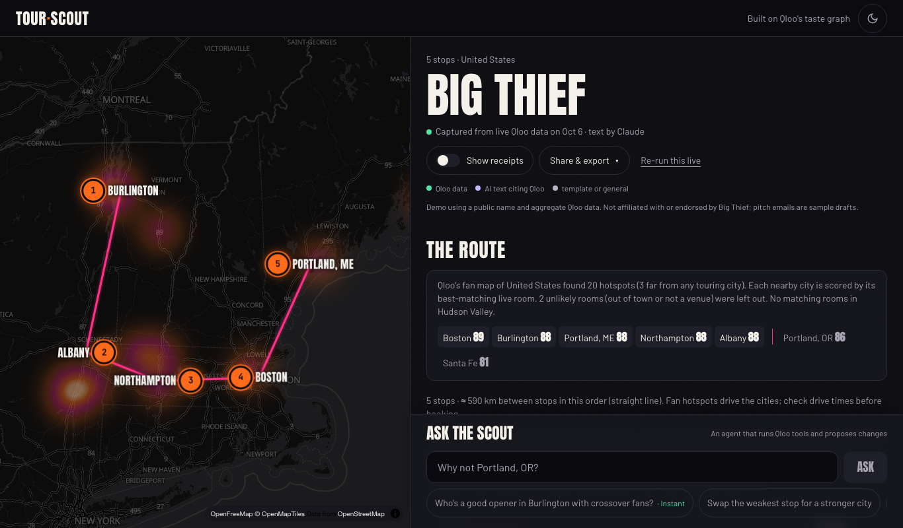
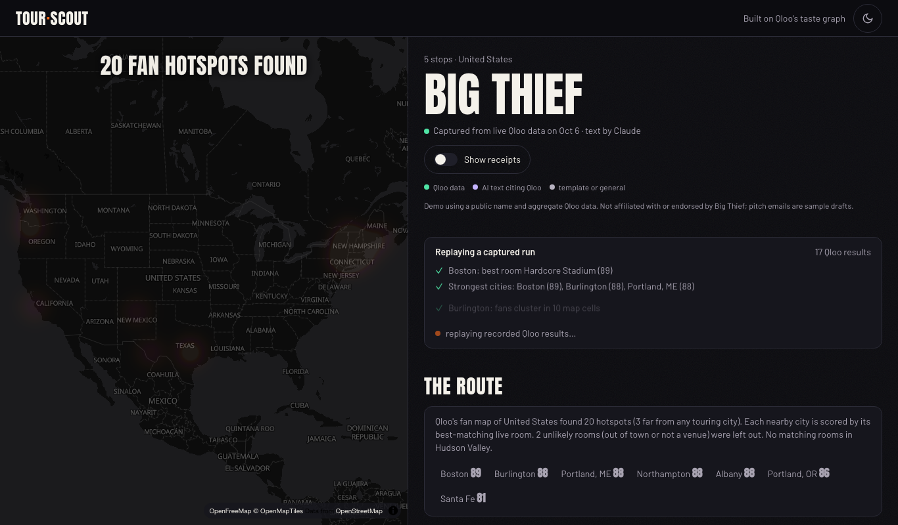
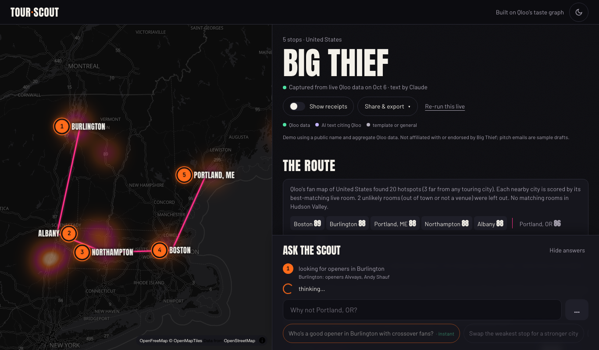
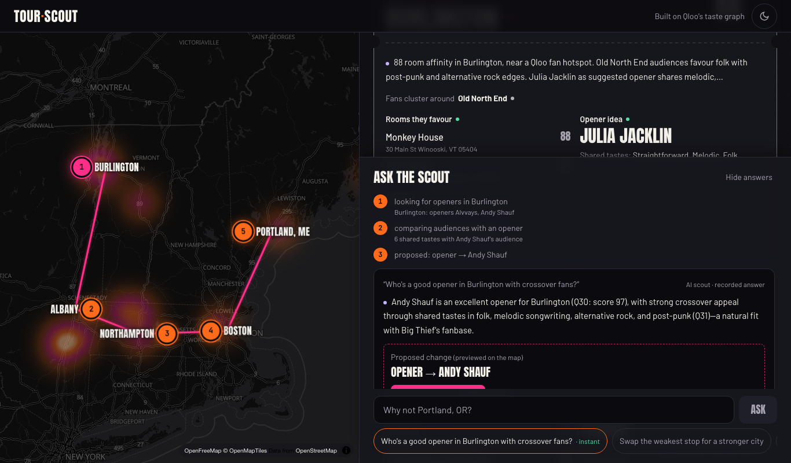
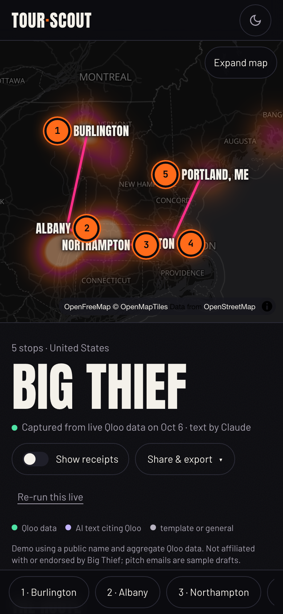
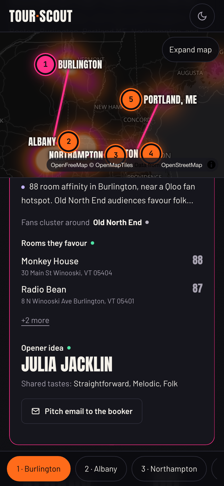
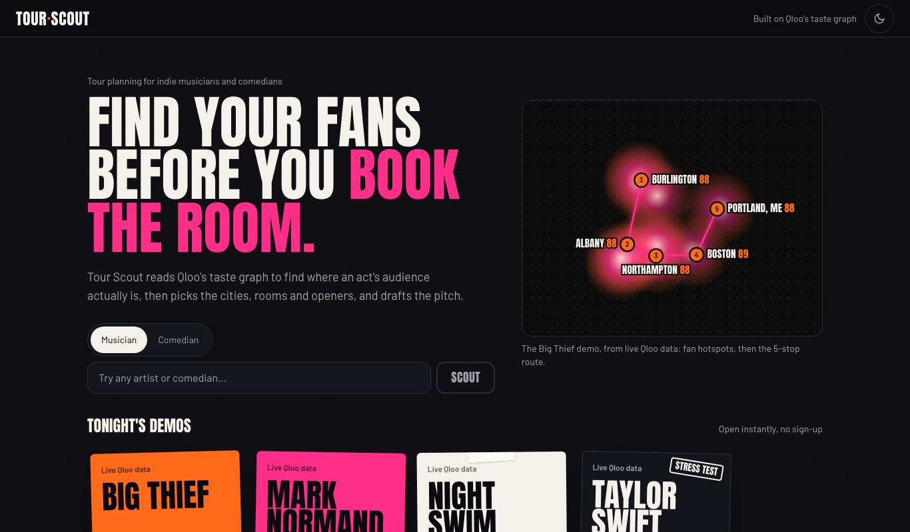
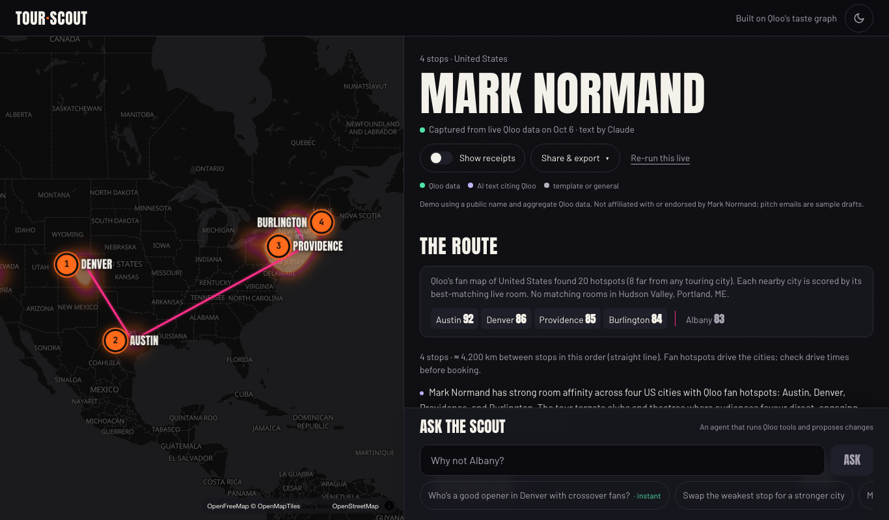
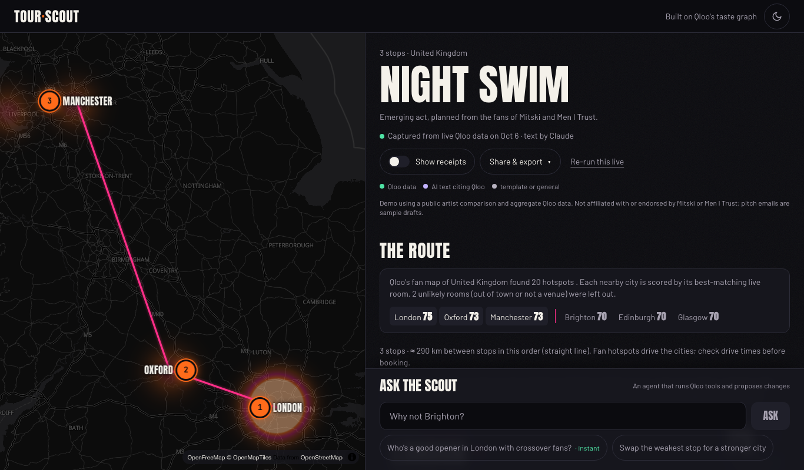
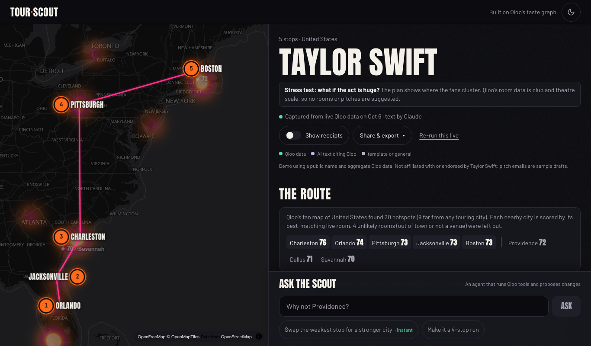

# Tour Scout

**Find your fans before you book the room.** Tour Scout plans a small tour for an indie musician or comedian from where their audience's taste actually is. It reads [Qloo](https://www.qloo.com)'s taste graph to find the act's fan hotspots across a country, scores each nearby city by the live rooms that audience favours, finds the neighbourhood where fans cluster, suggests an opener whose audience shares their tastes, and drafts a booker pitch for every stop. You can then ask an AI scout to rework the route, and apply its proposal with one tap.

Every number on screen is labelled **QLOO** (returned by Qloo), **AI** (model text citing Qloo evidence), **TEMPLATE** (text filled in by code), or **GENERAL** (model text with no Qloo support). Each label links to the exact Qloo request behind it.

Built for the Qloo Agentic Hackathon. MIT licensed.



All screenshots show **live Qloo data** (captured runs from 6 Oct 2026; text by Claude Haiku 4.5).

## Try it in 60 seconds

1. Open the app (hosted link: _pending_) and tap a **demo poster** such as *Big Thief*. A run captured from live Qloo data replays instantly:
   - **the fan map lights up**: Qloo's country-wide hotspots bloom as heat;
   - candidate cities get their scores;
   - the camera eases to the winners and the route draws itself.
2. In **Ask the scout** (docked at the bottom; a bottom sheet on phones), tap the suggestion marked **instant**. It replays a recorded agent run at no cost: the numbered trace, the answer and a proposed change.
3. Tap **Apply to my tour**. The change is scouted with fresh Qloo calls and the route redraws.
4. Flip **Show receipts**. Every value shows its provenance label and the Q-id of the Qloo request behind it; tap a Q-id to see the request.
5. Type any artist or comedian in the search box, confirm the **"Did you mean…?"** card, and scout a live tour.



## The problem

Independent musicians, comedians and their managers usually route tours by guesswork: a city they played before, a friend's venue, a promoter's offer. An empty room costs them money directly. Larger acts have agents and data teams; small acts do not. They need to know:

- Which cities have the most people who like this kind of act?
- Where in each city do those fans concentrate, and which rooms fit that taste?
- Who could open the show and bring overlapping fans?
- How do I pitch the booker without overselling?

## What makes it Qloo-powered

Qloo's taste graph links artists, comedians, places, brands and films through real-world audience affinity across 250M+ entities in music, film, dining, fashion and more (per the [hackathon page](https://qloo.devpost.com)). Tour Scout depends on that graph at every step:

- **Where the fans are.** One country-wide `where_popular` heatmap finds the act's fan hotspots; each hotspot is snapped to the nearest touring city. Inside each chosen city a second `where_popular` finds the neighbourhood where the fans cluster.
- **Which cities to play.** Every candidate city is scored by **room affinity**: `recommend` (places, filtered to that city with Qloo's "live music venue" or "comedy club" tag) returns the rooms this audience favours, and the city's score is its best room's affinity. Because it is the same signal scored against places, scores compare cities directly, so your own shortlist, "Why not Denver?" and the scout all use it.
- **Who they are, in aggregate.** `entity_tags` gives the fan fingerprint, `audience_demographics` the age and gender affinity, and cross-domain `recommend` covers the brands and films the fans like.
- **Rooms and openers.** The rooms behind each city's score are its suggested venues. Openers come from `recommend` (artists, or people with Qloo's comedian tags), never more popular than the act and never a member or side project of it, with shared tastes from `compare_audiences`.
- **Emerging acts.** An act Qloo doesn't know yet is planned from the fans of 1–3 artists it sounds like, and every screen says so. Its "opener" becomes a *support slot to pitch for*: an established act with overlapping fans that the new act could open for.

Without Qloo there is nothing to rank.

## How the agent works



```
Search ──► describe (Qloo) ──► "Did you mean…?"  (the user confirms the entity)
                                     │
Phase A — data gathering (code-planned, parallel, streamed)
  fingerprint · cross-domain · fan hotspots ─► room affinity per city ─► per stop: cluster, opener ─► overlap
  every Qloo call is recorded as evidence Q1, Q2, …
                                     │
Phase B — one model call (Claude Haiku 4.5, streamed per stop)
  writes "why", the pitch email, theme, merch and risks, citing Q-ids
                                     │
Ask the scout — tool-using agent (Claude Haiku 4.5, up to 4 rounds)
  tools: rank_cities · find_cities · fan_cluster · find_venues · find_openers · audience_overlap
  ends with propose_change ──► server validates ──► "Apply" rebuilds the plan
```

- **Phase A is planned in code, not by a model.** The data each tour needs is the same every time, so a model planning those calls would only add latency and cost. Independent calls run concurrently, and each stop streams to the screen as soon as its data lands.
- **Phase B is one model call.** It sees only the evidence ledger (values and Q-ids), never raw responses. Each stop's text appears as soon as the model has written it.
- **The scout is the agent.** For free-form requests ("Swap the weakest stop for somewhere in the South", "Who's a good opener in Chicago with crossover fans?"), Claude chooses and chains Qloo tools and then proposes a change. The server accepts a proposal only if:
  - every added city appeared in one of this session's tool results;
  - every removed stop exists, and the tour keeps 2–6 stops;
  - an opener is set only on a stop that stays;
  - every cited Q-id is real.
- **Quick questions skip the model.** "Why not Denver?" runs a fast path with no model call: `rank` plus `where_popular`, answered from a template.
- **Applying a proposal** scouts each new stop the same way a full run does, re-optimises the route, and saves a new plan linked to the original.



### Route order

The route is the shortest open path through the stops: exact for up to 8 stops, 2-opt beyond. It therefore never crosses itself, and it starts at whichever end has the stronger fan affinity. Tests check this on 50 random sets of cities.

## Qloo requests, redacted

All Qloo calls go through the public [`@qloo/qloo-harness`](https://github.com/qloo/qloo-hackathon-kit) CLI (0.1.26), the event's supported surface, against `https://hackathon.api.qloo.com`. Every call is a validated `qloo exec` workflow. The Sources panel ("Credits") shows every request; requests never contain credentials.

**Entity and tag choices.** The act is confirmed by the user on a "Did you mean…?" card before anything else runs (here `Big Thief`, artist, popularity 0.991). The room tag is chosen once per run with `find_tags`: `urn:tag:category:place:live_music_venue` for musicians, `urn:tag:category:place:comedy_club` for comedians. Comedian openers are filtered with Qloo's comedian tags (`urn:tag:genre:person:comedian`, stand-up occupation tags), because unfiltered `person` results for a comedian are mostly actors.

**Request → result, from the live Big Thief preset** (United States, 5 stops, 300–900 cap; 29 requests in total):

```text
Q6   where_popular   GET /v2/insights  filter.type=urn:heatmap, signal.interests.entities=<Big Thief>,
                                       filter.location.query=United States, take=20
     → 20 hotspot cells (~30 km each). Snapped to touring cities: Northampton, Burlington, Portland ME,
       Santa Fe, Albany, Hudson Valley, Portland OR, Boston, Austin, Seattle. 3 cells far from any
       touring city (e.g. far West Texas) are counted, not scheduled.

Q8   recommend       GET /v2/insights  filter.type=urn:entity:place, signal.interests.entities=<Big Thief>,
                                       filter.location.query=Burlington, Vermont,
                                       filter.tags=urn:tag:category:place:live_music_venue, take=6
     → Monkey House 88 · Radio Bean 87 · ArtsRiot 86 · Nectar's 86   ⇒ Burlington room affinity 88
       (rooms that are not venues, or more than 18 km out of town, are dropped first: in Albany a
       farm 20 km away; in the Hudson Valley a heritage railway, which left that city unscored)

Q7–Q14 (same request for each candidate city)
     → Boston 89 · Burlington 88 · Portland ME 88 · Northampton 88 · Albany 88 · Portland OR 86 · Santa Fe 81
       ⇒ stops: the five best, routed Burlington → Albany → Northampton → Boston → Portland ME

Q15  where_popular   GET /v2/insights  filter.type=urn:heatmap, filter.location.query=Burlington, Vermont, take=10
     → strongest cell named via OpenStreetMap: Old North End

Q18  recommend       GET /v2/insights  filter.type=urn:entity:artist, signal.location.query=Burlington, Vermont, take=8
     → Julia Jacklin (first candidate that is not the act, not a member of it, and not more popular)

Q25  compare_audiences GET /v2/analysis/compare  a=<Big Thief>, b=<Julia Jacklin>
     → shared taste tags: Straightforward, Melodic, Folk, Simple Chord Progressions, Post Punk, Alternative Rock
```

The other three presets, all captured live the same day: **Mark Normand** (stand-up; fan hotspots with comedy rooms in Austin 92 (The Creek & The Cave, The Velveeta Room), Denver 86 (Comedy Works), Providence 85 and Burlington 84 (Vermont Comedy Club); openers Joe DeRosa, Annie Lederman, Gary Gulman, Dan Soder), **Night Swim**, an emerging act planned from fans of Mitski and Men I Trust (London 75, Oxford 73, Manchester 73 with Band on the Wall), and **Taylor Swift** as an arena-scale test (Charleston 76, Orlando 74, Jacksonville, Pittsburgh and Boston 73), which shows where the fans are and says plainly that the suggested rooms are clubs and theatres, not arenas. Presets use public names and aggregate data only and are labelled "Demo, not affiliated with or endorsed by" the act.

**What the hackathon API does not support, and what Tour Scout does instead** (verified in the M0 spike; recorded responses are in `tests/fixtures/`):

| Tried | Result | Instead |
| --- | --- | --- |
| `recommend`/`rank` with a `locality` target | Rejected by the harness (`TOOL_INPUT`) | Country-wide `where_popular` hotspots → touring cities → room affinity |
| Raw `urn:entity:locality` insights via `qloo api` | Popularity-ordered states and cities with no affinity for the signal | (same) |
| `output.heatmap.boundary=city` | HTTP 400 | Hotspot cells snapped to a list of touring cities (`src/lib/markets.ts`) |
| Heatmaps through `qloo api insights` | The CLI prints only `results.entities`, so heatmap cells are dropped | One `where_popular` per proxy artist, merged per cell |
| `entity_tags` as the fan fingerprint | Mixed with place, business and identity tags | Only Qloo theme, style, audience, category and music tag families are shown; identity terms are never shown |

## Responsible data handling

Built to the kit's [safe-use rules](https://github.com/qloo/qloo-hackathon-kit/blob/main/docs/SAFE_USE.md):

- **Aggregate only.** No personal data is sent to Qloo. Inputs are an act's name, a region or cities, a stop count and an optional room size. Demographics are shown as relative over- or under-indexing for the audience as a whole, labelled "not a headcount, and not about any one fan".
- **Affinity is not a forecast.** Room affinity (0–100) ranks cities against each other; a tap-to-open explainer and the CSV header say so. Pitches never promise turnout.
- **No identity tags.** Qloo's tag results for an act can include ethnicity or sexuality tags; Tour Scout shows only taste families (themes, styles, music genres) and drops identity terms, so fans are never described by sensitive traits.
- **Thin data is labelled.** When hotspots fall mostly outside touring cities, when cities had to be added from room affinity, or when Qloo returns few taste tags (common for comedians), the plan shows a "Limited data" note instead of padding.
- **A deterministic guard** (`src/lib/guard.ts`) withholds any model text that mentions income, wealth or class, sensitive traits, certainty or causation, attendance or ticket forecasts, individual fans, claims that a room fits the capacity (Qloo has no capacity data), targeting of an age or gender group, or affinity presented as "confirmed" demand. The plan says how many statements were withheld and why (the Night Swim preset shows one). Room sizes are the user's own input: any room-size range the user did not give is withheld, and a withheld summary falls back to a templated one.
- **Provenance is never overstated.** Text from code is labelled TEMPLATE, never AI. Citations to Q-ids that don't exist are dropped, and the text is then labelled GENERAL.
- **Server-owned plans.** Share links serve only plans this server generated; a client cannot upload a plan.
- **Credentials stay server-side.** Keys are read from the server environment and never reach the browser, the model or the logs. `npm run qloo:key` stores the Qloo key with hidden input.

## Reliability and quota protection

| Situation | What happens |
| --- | --- |
| No Qloo credential | Demo mode with sample data, labelled "SAMPLE" everywhere and with a banner |
| Credential set but harness missing or broken | Clear "Qloo connection isn't set up" error, never silent sample data |
| Qloo rejects the key | The run stops with a named error; demo tours stay available |
| Qloo rate-limits (seen in testing during back-to-back tours) | The harness retries 429s itself (3 attempts, honouring Retry-After); Tour Scout then waits ~8 s and retries once; if still limited, the run stops with a named error and demo tours stay available |
| One Qloo call fails or times out (45 s) | That step is marked failed; the rest of the plan continues |
| Model unavailable, over quota or over the daily cap | Text falls back to templates (labelled), and the scout falls back to a templated scout (labelled) |
| Same tour requested again within 24 h | The stored plan replays instantly at no quota cost |
| Too many requests from one client | 429 with a friendly message and an "Open a demo tour" button (per hour: 4 tours, 40 searches, 15 scout questions or applies; all configurable) |
| Server-wide daily cap on live tours (150) | Same message; demo tours keep working |
| OpenStreetMap naming unavailable | Neighbourhoods show as "one part of the city"; nothing else breaks |
| Unknown share link | Branded 404 page |

Model spend is bounded by `LLM_DAILY_CAP` (default 40 calls a day), and every call logs its token counts (counts only). Measured on Claude Haiku 4.5 with live Qloo data (6 Oct 2026):

| Operation | Model calls | Tokens (input + output) | Cost |
| --- | --- | --- | --- |
| One tour's text | 1 | ≈ 2.4–2.8k + 1.4–2.3k | ≈ $0.01 |
| One scout question | 2–4 | ≈ 3.7k + 0.4k (2 calls) | < $0.01 |

Latency on the event API: a Qloo call takes about 2.6 s median (including ~0.5 s harness start), with occasional 6–9 s calls; a live tour's Qloo phase takes 25–40 s and the streamed text another 15–20 s. Tickets appear as each stop's data lands, so the screen fills well before the end.

## Setup from a clean environment

Requirements: Node.js 22.19 or newer, an event-issued Qloo credential, and a Claude API key (optional: without it, text is templated).

```sh
# 1. Qloo harness (the supported way to call Qloo for this event)
npm install --global @qloo/qloo-harness@0.1.26

# 2. App
git clone <repo-url> tour-scout && cd tour-scout
npm ci
cp .env.example .env.local            # set CLAUDE_API_KEY (and LLM_PROVIDER=claude)

# 3. Qloo credential (input is hidden; never pass the key as an argument)
npm run qloo:key                      # or: qloo setup --qloo

# 4. One small live check of the workflows Tour Scout uses (~25 requests; cached on disk for 24 h)
npm run qloo:verify-tour

# 5. Run
npm run dev                           # http://localhost:3898
```

**Without any keys:** run `QLOO_MOCK=1 npm run dev`. The whole flow works on sample data, with templated text and the templated scout.

**Docker** (the harness is a local process, so deploy to a VM or container, not serverless):

```sh
docker build -t tour-scout .
docker run -p 8080:8080 -v tour-scout-data:/data -e QLOO_API_KEY -e CLAUDE_API_KEY tour-scout
```

| Variable | Default | Purpose |
| --- | --- | --- |
| `QLOO_API_KEY` | — | Event credential (or use the harness's own config) |
| `QLOO_BASE_URL`, `QLOO_TRUSTED_BASE_URL` | `https://hackathon.api.qloo.com` | Where the harness sends requests |
| `LLM_PROVIDER` | `scripted` | `claude` (primary), `gemini`, or `scripted` (no model) |
| `CLAUDE_API_KEY`, `CLAUDE_MODEL` | — / `claude-haiku-4-5-20251001` | Deliberately not `ANTHROPIC_API_KEY`, so no other tool picks it up |
| `LLM_DAILY_CAP` | `40` | Model calls per UTC day |
| `TOUR_RUNS_PER_HOUR`, `RESOLVES_PER_HOUR`, `FOLLOWUPS_PER_HOUR`, `TOUR_DAILY_CAP` | `4`, `40`, `15`, `150` | Quota protection |
| `DATA_DIR` | `.cache` (`/data` in Docker) | Share links, LLM budget counter, geocoding cache |
| `QLOO_CONCURRENCY` | `3` | Parallel harness processes (4 hit the event rate limit in testing) |
| `QLOO_CACHE_DIR`, `QLOO_CACHE_TTL_H` | — / `24` | Optional on-disk cache of Qloo responses for scripts and development |

**Hosting:** a Docker web service on Render (`render.yaml`); the exact steps, costs and caps are in [`docs/DEPLOY.md`](docs/DEPLOY.md). Nothing is deployed yet.

**Demo video:** `scripts/video/make-draft.sh <out_dir>` builds a captioned draft (Kokoro voice, scripted Playwright takes, ffmpeg) from `video/scenes.json`. It makes one live tour and one scout question; everything else replays that run.

**Demo presets** are captured live runs in `public/presets/`. Recapture them with `LLM_PROVIDER=claude npm run presets:capture [slug…]`; a live capture costs 21–29 Qloo requests and one model call per preset.

**Checks:** `npm test` (35 tests: guard, pipeline, routing, scout agent, apply, store, CSV, limits, and adapter tests against recorded live Qloo responses in `tests/fixtures/`), `npm run lint`, `npx tsc --noEmit`, `npm run build`.

## Screens

| Mobile route | Mobile stop ticket | Landing |
| --- | --- | --- |
|  |  |  |

| Stand-up comedian (US) | Emerging act from "sounds like" artists | Arena-scale test |
| --- | --- | --- |
|  |  |  |

## Project layout

| Path | What it does |
| --- | --- |
| `src/lib/qloo.ts`, `qloo-mock.ts` | Qloo client over the harness CLI: adapters, cache, concurrency, errors; labelled sample data |
| `src/lib/tour/cities.ts`, `src/lib/markets.ts` | Fan hotspots → touring cities → room affinity |
| `src/lib/tour/pipeline.ts` | Phase A: the per-stop scouting pipeline and evidence recording |
| `src/lib/tour/plan.ts` | Full run, route ordering, plan assembly with the guard |
| `src/lib/tour/scout.ts`, `apply.ts` | The tool-using scout agent and applying its proposals |
| `src/lib/llm.ts` | Phase B synthesis: Claude (primary), Gemini (fallback), scripted; daily cap and usage logging |
| `src/lib/guard.ts` | Provenance labels and the safe-use guard |
| `src/lib/limits.ts`, `store.ts` | Quota protection, run reuse, share-link storage |
| `src/app/api/tour/*` | Streaming endpoints: resolve, tour, ask, apply, health |
| `src/components/tour/*` | UI: landing, resolve card, map, tickets, scout panel, credits |
| `scripts/` | Hidden-input key setup, live verification, preset capture |

## Known limitations

What a plan does **not** establish:

- **Fan affinity is not ticket demand.** It ignores dates, routing costs, competing shows, venue availability, capacity and price. Confirm all of these with bookers.
- **Scores rank places against each other.** They are not percentages of people and not predictions about any individual. A city's score is its best room's affinity, so a city with one excellent room can outrank a bigger city.
- **Touring cities are a fixed list.** Hotspots are snapped to about 100 touring cities in the US, India, the UK, Canada and Australia. Hotspots far from all of them (national parks, resort areas, Ladakh) are counted but not scheduled; other countries rely on room affinity alone.
- **Qloo's venue tag is broad.** "Live music venue" includes some galleries, bars and halls, and occasionally an odd one (a heritage railway in the Hudson Valley). Every room is a suggestion to check.
- **Taste tags vary by act.** Qloo returns few usable taste tags for some acts (some comedians, and even Taylor Swift); the fan profile says "Limited data" rather than padding it.
- **Coverage outside the US and UK is thinner.** For India, most hotspots fell outside touring cities (tested in M0), so cities are added from room affinity and the plan says "Limited data".
- **Openers are suggestions.** They are similar acts with local affinity, not checked for availability or willingness.
- **Qloo has no venue capacity.** Your room size is used only as text in the pitch, labelled as your target.
- **Neighbourhood names are approximate.** They come from reverse-geocoding the centre of the strongest Qloo map cell, so a cell can straddle areas.
- **Coverage varies by country and by act.** Small or very new acts may need emerging-act mode. Arena-scale acts (Qloo popularity ≥ 0.999, e.g. Taylor Swift) still get a plan of where their fans are, but the suggested rooms are clubs and theatres, not arenas, and the plan says so.
- **New stops get templated text.** Stops added through "Apply" have no model-written text, to keep model spend bounded.
- **The guard is keyword-based.** It catches the known failure modes but is not exhaustive; provenance labels remain the main safeguard.
- **Map tiles come from OpenFreeMap's public instance** (free, no key, public use allowed); a heavy production load would self-host the same tiles.
- **Single instance.** Limits, caches and the scout's state are in-memory per server process; plans persist under `DATA_DIR`.

## License and credits

[MIT](LICENSE) © 2026 Harsha Shinde. Taste data by [Qloo](https://www.qloo.com). Map: [OpenFreeMap](https://openfreemap.org) © OpenMapTiles, data © [OpenStreetMap](https://www.openstreetmap.org/copyright) contributors, rendered with [MapLibre GL JS](https://maplibre.org). Fonts: Anton, Barlow and JetBrains Mono (Google Fonts). Plan text and the scout agent use [Claude](https://www.anthropic.com/claude).
