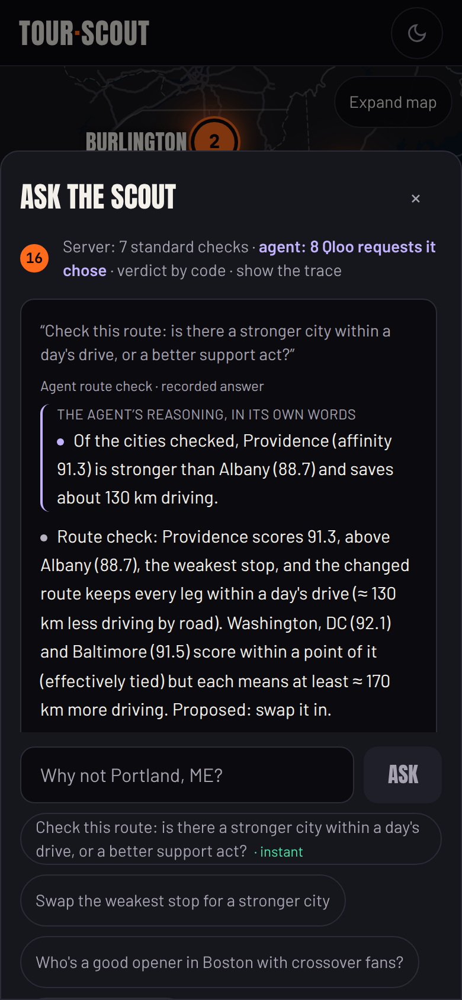
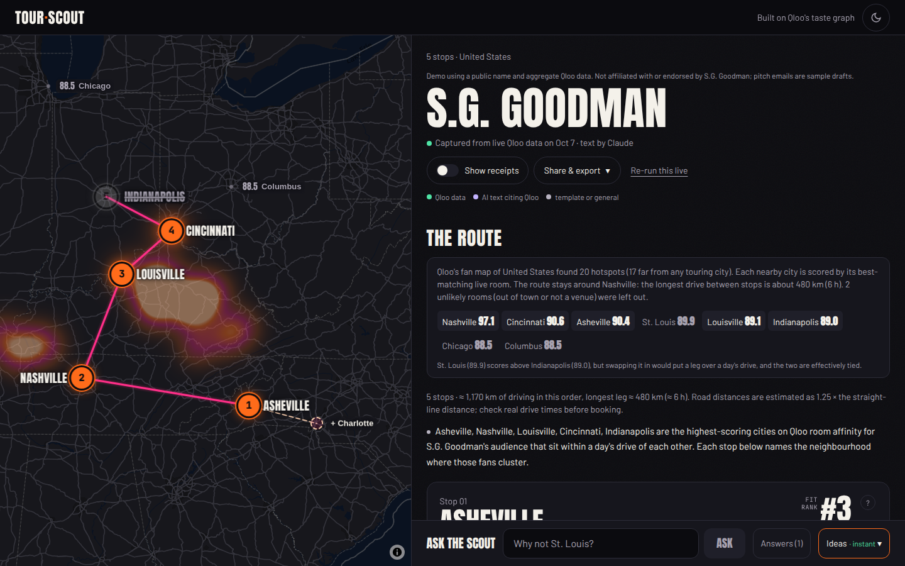
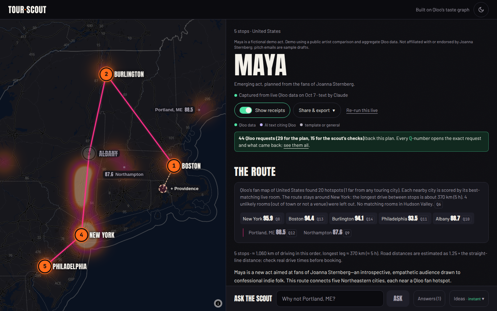
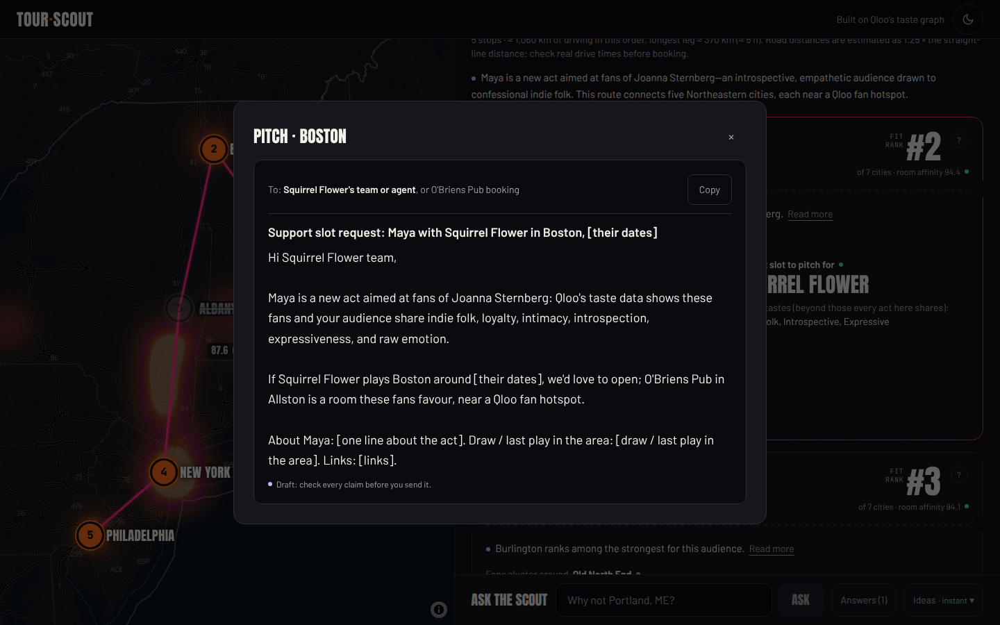

# Tour Scout

**Plan a tour before you have listeners there.** Find your fans before you book the room: Tour Scout plans a small tour for an indie musician or comedian from where their audience's taste actually is, using [Qloo](https://www.qloo.com)'s taste graph (a new act can plan from the artists it sounds like), then the route-check agent tests the plan with Qloo tools and proposes at most one change.

**Try it:** [tour-scout-196979752200.us-central1.run.app](https://tour-scout-196979752200.us-central1.run.app) · **Video (1:27):** [YouTube](https://youtu.be/82Q6wTS93Xs) · **Code:** this repo (MIT)


*Replay of a run captured from live Qloo data on 7 Oct 2026. Maya is a fictional demo act planned from the fans of Joanna Sternberg. The GIF ends on the agent's swap: Albany (88.7) out, Providence (91.3) in.*

### Check it yourself in 5 minutes

No sign-up. A demo poster replays a run captured from live Qloo data in about 10 seconds (the live run took 47 s), so watching one costs nothing. Apply and your own searches run live.

| Time | Do this | You should see | What it shows |
| --- | --- | --- | --- |
| 0:00 | Open the [app](https://tour-scout-196979752200.us-central1.run.app) and tap the **Maya** poster | The fan map blooms, 7 cities get scores, and the route draws: Boston → Burlington → Albany → New York → Philadelphia | The plan starts from where the fans are (Qloo's fan map), not from listener counts |
| 0:30 | Wait for the **route check** in the dock (a bottom sheet on phones) | A numbered trace: 7 server requests, then 8 Qloo requests the agent chose. Then a proposal: Providence (91.3) for Albany (88.7), still drivable, about 130 km less driving | An agent tests the plan with Qloo tools and earns its one proposal |
| 1:30 | Tap **Apply to my tour** | The route redraws through Providence, saved as your own copy | A proposal is one tap from a new plan |
| 2:30 | Flip **Show receipts**, then tap any Q-number | Every value carries QLOO, AI, TEMPLATE or GENERAL and the exact Qloo request behind it | Nothing on screen is uncited |
| 3:30 | Back to the start; tap **Joe List** (stand-up) | Comedy clubs, openers flagged "above your size fit", and a route check that says the route **holds** | The agent does not change things for show |
| 4:30 | Optional, offline: `npm ci && npm run eval` | The table in [docs/EVALUATION.md](docs/EVALUATION.md) | The claims below, re-checked without any API call |

**Evidence so far, with its limits:**
- **The product keeps its promises on all three demo plans** ([docs/EVALUATION.md](docs/EVALUATION.md), offline): 177 of 177 Qloo values cite a real request, 48 of 48 AI sentences cite real requests, 12 of 12 legs are within a day's drive, 15 of 15 openers fit the size rule or carry the flag, and the 3 recorded route checks pass 14 of 14 independent re-checks.
- **The guard is a second line, not a proof.** On a held-out set of 25 overclaims it had not seen, it withheld 14 and wrongly withheld 1 of 25 ordinary sentences. The misses are listed.
- **Outcomes are not shown yet.** A check against two acts' past show lists was inconclusive ([docs/BACKTEST.md](docs/BACKTEST.md)), and no real act has used it yet.

It finds the act's fan hotspots across a country, scores each nearby city by the live rooms that audience favours, finds the neighbourhood where fans cluster, suggests an opener (or, for a new act, a support slot) whose audience shares their tastes, and drafts a pitch for every stop. It works in two layers: **a deterministic plan you can audit** (every Qloo call is planned in code, and every number cites its request), then **an agent route check** that runs Qloo tools to test that plan and proposes at most one revision, which the server verifies against the agent's own numbers before you apply it with a tap. If the agent misses a stronger city within a day's drive, the server proposes that swap itself and the card says so.

Every number on screen is labelled **QLOO** (returned by Qloo), **AI** (model text citing Qloo evidence), **TEMPLATE** (text filled in by code), or **GENERAL** (model text with no Qloo support). Each label links to the exact Qloo request behind it.

**Why not Spotify for Artists, Chartmetric or Bandsintown?** Those show where an act's existing listeners and followers are. Tour Scout answers a different question with Qloo's cross-domain taste graph: where the people who would *like* this act are, even before it has listeners (emerging-act mode plans from "sounds like" artists), which live rooms that audience favours, which acts share its tastes (openers and support slots), and which brands it favours (sponsor leads). Streaming counts can't name a room or an opener.

Built for the Qloo Agentic Hackathon. MIT licensed. Built with AI coding assistance; the demo video's voiceover is synthetic (Kokoro TTS). All screenshots show **live Qloo data** (captured runs from 7 Oct 2026; text by Claude Haiku 4.5). "Maya" is a fictional first-tour act; the other demos use public names with a "not affiliated" note.


## Try it in 60 seconds

1. Open the [hosted app](https://tour-scout-196979752200.us-central1.run.app) and tap a **demo poster**, such as *Maya* (a fictional first-tour act that sounds like Joanna Sternberg). A run captured from live Qloo data replays instantly:
   - **the fan map lights up**: Qloo's country-wide hotspots bloom as heat;
   - candidate cities get their scores;
   - the camera eases to the winners and the route draws itself.
2. When the route is drawn, the **agent route check** starts by itself in the dock at the bottom (on phones it opens as a bottom sheet). On a demo it replays a recorded agent run at no cost: the numbered tool trace, then its verdict. The finished trace is split into who did what: the server's standard check (Maya: 7 Qloo requests, the rooms in the nearby cities), the requests the agent chose itself (Maya: 8, support acts in every stop and three audience comparisons), and the verdict, written by code. For Maya it ranks the touring cities near the route, and proposes swapping Albany (88.7) for Providence (91.3): stronger, every leg still within a day's drive, and about 130 km less driving by road. The verdict also says that Washington, DC (92.1) and Baltimore (91.5) score within a point of Providence (effectively tied) but each means at least 170 km more driving. The card shows that the agent made this proposal and, labelled AI, the agent's own reason: "Of the cities checked, Providence (affinity 91.3) is stronger than Albany (88.7) and saves about 130 km driving." The verdict quotes the same driving estimate as the agent's tool, rounded the same way.
3. Tap **Apply to my tour** and the route redraws. (On the *Joe List* demo the route check says the route holds and why: Providence (85.5) is the weakest stop, and the cities near the route, Albany (83.6) and Baltimore (81.1), score lower. The agent doesn't change things for show, and the server checks that its verdict matches its own numbers.)
4. Flip **Show receipts**. Every value shows its provenance label and the Q-id of the Qloo request behind it; tap a Q-id to see the request.
5. Type any artist or comedian in the search box, confirm the **"Did you mean…?"** card, and scout a live tour.


## The problem

Independent musicians, comedians and their managers usually route tours by guesswork: a city they played before, a friend's venue, a promoter's offer. An empty room costs them money directly. Larger acts have agents and data teams; small acts do not. They need to know:

- Which cities have the most people who like this kind of act?
- Where in each city do those fans concentrate, and which rooms fit that taste?
- Who could open the show and bring overlapping fans?
- How do I pitch the booker without overselling?

### Who it is for, and what it replaces

- **For:** independent musicians and comedians booking their own first or second run of club dates (100–500-capacity rooms), and the small managers who route for them.
- **The stakes are real money.** In a 2024 survey of 1,700 artists by the rehearsal-studio chain Pirate, 72% said they made no profit from recent touring and 24% operated at a loss ([Hypebot, 19 Jul 2024](https://www.hypebot.com/hypebot/2024/07/musicians-struggle-to-profit-from-live-shows-survey-reveals.html)). In Ditto Music's January 2025 survey of 1,500 independent artists, 82.1% said they can't afford to tour and 74.8% had never toured ([Ditto Music](https://press.dittomusic.com/82-of-independent-artists-cant-afford-to-tour-in-2025)). A tour that picks better cities can't fix costs, but it lowers the odds of an empty room.
- **What it replaces:** today the data an act has for routing is its own listener map. Spotify for Artists shows the top cities where an act's music is streamed, and Spotify suggests listener data "can help you figure out where to tour" ([Spotify for Artists](https://artists.spotify.com/blog/how-to-read-your-spotify-for-artists-data)). That needs listeners first, and it can't name a room, an opener or a booker pitch. Tour Scout starts from taste instead, so a new act can plan from the artists it sounds like, and every stop comes with rooms, an opener or support-slot idea, and a draft pitch.
- **What one run hands the act** (counted from the three demo plans, each captured live in 44–50 s): 5 stops with every leg drivable; 17–20 named rooms; the neighbourhood where fans cluster in each stop; an opener or support-slot idea per stop with the taste tags its audience shares; 5 booker pitches with blanks for dates, draw and price; and sponsor leads from the brands the audience favours. Every item cites the Qloo request behind it, so a manager can check it before sending anything.
- **Who else could use it:** a small manager or booking agent routing several acts, and (as a next step, not built) the reverse view for a room: which touring acts fit its audience.
- **What it does not do:** it doesn't forecast attendance or ticket sales, and it has not yet been tested with real acts. If you tour or book shows, [tell us what it got right or wrong](https://github.com/xexpertai/tour-scout/issues).

## What makes it Qloo-powered

Qloo's taste graph links artists, comedians, places, brands and films through real-world audience affinity across music, film, dining, fashion and more ([Qloo](https://www.qloo.com)). Tour Scout depends on that graph at every step:

- **Where the fans are.** One country-wide `where_popular` heatmap finds the act's fan hotspots; each hotspot is snapped to the nearest touring city. Inside each chosen city a second `where_popular` finds the neighbourhood where the fans cluster.
- **Which cities to play.** Every candidate city is scored by **room affinity**: `recommend` (places, filtered to that city with Qloo's "live music venue" or "comedy club" tag) returns the rooms this audience favours, and the city's score is its best room's affinity. Because it is the same signal scored against places, scores compare cities directly, so your own shortlist, "Why not Denver?" and the scout all use it.
- **Who they are, in aggregate.** `entity_tags` gives the fan fingerprint, `audience_demographics` the age and gender affinity, and cross-domain `recommend` covers the brands and films the fans like.
- **Rooms and openers.** The rooms behind each city's score are its suggested venues. Openers come from `recommend` (artists, or people with Qloo's comedian tags), never more popular than the act and never a member or side project of it, with shared tastes from `compare_audiences`.
- **Emerging acts.** An act Qloo doesn't know yet is planned from the fans of 1–3 artists it sounds like, and every screen says so. Its "opener" becomes a *support slot to pitch for*: an established act with overlapping fans that the new act could open for.

Without Qloo there is nothing to rank.

## How the agent works


```
Search ──► describe (Qloo) ──► "Did you mean…?"  (the user confirms the entity)
                                     │
Phase A — data gathering (code-planned, parallel, streamed)
  fingerprint · cross-domain · fan hotspots ─► room affinity per city ─► per stop: cluster, opener ─► overlap
  every Qloo call is recorded as evidence Q1, Q2, …
                                     │
Phase B — one model call (Claude Haiku 4.5, streamed per stop)
  writes "why", the pitch email, theme, merch and risks, citing Q-ids
                                     │
Ask the scout — tool-using agent (Claude Haiku 4.5, up to 4 rounds)
  tools: rank_cities · find_cities · fan_cluster · find_venues · find_openers · audience_overlap
  ends with propose_change ──► server validates ──► "Apply" rebuilds the plan
```

- **Phase A is planned in code, not by a model.** The data each tour needs is the same every time, so a model planning those calls would only add latency and cost. Independent calls run concurrently, and each stop streams to the screen as soon as its data lands.
- **Phase B is one model call.** It sees only the evidence ledger (values and Q-ids), never raw responses. Each stop's text appears as soon as the model has written it.
- **The scout is the agent.** For free-form requests ("Swap the weakest stop for somewhere in the South", "Who's a good opener in Chicago with crossover fans?"), Claude chooses and chains Qloo tools and then proposes a change. The server accepts a proposal only if:
  - every added city appeared in one of this session's tool results;
  - every removed stop exists, and the tour keeps 2–6 stops;
  - an opener is set only on a stop that stays;
  - every cited Q-id is real.
- **Quick questions skip the model.** "Why not Denver?", or the suggested "Why not Portland, ME?" (one place name, with an optional ", region"), runs a fast path with no model call: the city's room affinity (`recommend` with the venue tag) plus `where_popular`, answered from a template and labelled "no AI".
- **Applying a proposal** scouts each new stop the same way a full run does, re-optimises the route, and saves a new plan linked to the original.


### Route order

**Openers and support slots are sized to the act.** An opener is chosen from acts no more popular on Qloo than the act; when no act with local affinity is that small, the closest one is shown with a visible "above your size fit" flag (Joe List's demo shows four). In emerging-act mode the new act pitches for a *support slot* on another act's show, so that act may be bigger, but not beyond small rooms: its Qloo popularity must be at most 0.92. From the demo data, acts that tour 100–500-capacity rooms sit at about 0.56–0.91 (Joanna Sternberg 0.56, Mikaela Davis 0.78, Tomberlin 0.91), theatre-level acts at 0.96 and up. Qloo has no venue capacities, so this popularity line is the proxy for "fits your room target". The agent can never swap to a bigger act than a stop's current one.

**The route is a drivable run, not a zig-zag.** Tour Scout works in the region where most of the act's fan hotspots sit (or around an optional starting city) and scores up to three more cities than the stops asked for: the hotspot cities in that region first, then, only when those don't fill the list, the touring cities nearest the region's anchor (the hotspot city with the most hotspots around it, or your starting city); if the list is still short, cities with rooms this audience favours. It then picks the strongest stops whose driving order has no leg over 400 km straight-line (about 500 km, about 6 h by road). Hotspots elsewhere are named as "a second run", and a strongly scored city too far from the route is marked "outside this run" with its distance (Joe List's demo: Austin). If fewer strong cities fit, the plan has fewer stops and says so. The order is the shortest open path through the stops (exact for up to 8, 2-opt beyond), so it never crosses itself. Scores are shown as a fit rank ("#2 of 7") with Qloo's room affinity beside it, because one audience's room affinities sit close together; the plan says when stops are effectively tied.

## Qloo requests, redacted

All Qloo calls go through the public [`@qloo/qloo-harness`](https://github.com/qloo/qloo-hackathon-kit) CLI (0.1.26), the event's supported surface, against `https://hackathon.api.qloo.com`. Every call is a validated `qloo exec` workflow. The Sources panel ("Credits") shows every request; requests never contain credentials.

**Entity and tag choices.** The act is confirmed by the user on a "Did you mean…?" card before anything else runs (for example `Joe List`, person, popularity 0.626; in emerging-act mode, each "sounds like" artist is confirmed the same way). The room tag is chosen once per run with `find_tags`: `urn:tag:category:place:live_music_venue` for musicians, `urn:tag:category:place:comedy_club` for comedians. Comedian openers are filtered with Qloo's comedian tags (`urn:tag:genre:person:comedian`, stand-up occupation tags), because unfiltered `person` results for a comedian are mostly actors. `recommend` results carry no description, so the candidate about to be picked is looked up with `describe` (receipted) and skipped if Qloo describes it as a supergroup or, for a comedian, first as an actor with no stand-up ("Canadian actor and comedian"). Qloo's comedy-club tag also matches music bars that host comedy nights, so for a comedian the rooms whose names say they are comedy clubs are listed first and get the pitch; the city's score is still its best room's affinity.

**Request → result, from the live Maya preset** (fans of Joanna Sternberg, United States, 5 stops, 100–300 cap; 29 requests for the plan, plus 15 for its recorded route check, so Credits shows 44):

<!-- request-excerpt:start (generated by `npm run docs:excerpt` from public/presets/us-emerging.json) -->
```text
Q6   where_popular   GET /v2/insights  filter.type=urn:heatmap, signal.interests.entities=<Joanna Sternberg>,
                                       filter.location.query=United States, take=20
     → 20 hotspot cells (~30 km each), near touring cities: New York, Boston, Burlington, Philadelphia, Albany, Portland ME, Northampton, Hudson Valley.
       1 cell far from any touring city is counted, not scheduled.

Q13  recommend       GET /v2/insights  filter.type=urn:entity:place, signal.interests.entities=<Joanna Sternberg>,
                                       filter.location.query=Boston, Massachusetts,
                                       filter.tags=urn:tag:category:place:live_music_venue, take=6
     → O'Briens Pub 94.4 · Midway Café 91.5 · Club Passim 90.1 · The Jungle Community Music Club 89.8   ⇒ Boston room affinity 94.4
       (rooms that are not venues, or more than 18 km out of town, are dropped first; 4 were in this run)

Q7–Q14 (the same request for each candidate city)
     → New York 95.9 · Boston 94.4 · Burlington 94.1 · Philadelphia 93.5 · Albany 88.7 · Portland ME 88.5 · Northampton 87.6
       ⇒ stops: the 5 best within a day's drive of each other, routed Boston → Burlington → Albany → New York → Philadelphia

Q16  where_popular   GET /v2/insights  filter.type=urn:heatmap, filter.location.query=Boston, Massachusetts, take=10
     → strongest cell named via OpenStreetMap: Church Green

Q18  recommend       GET /v2/insights  filter.type=urn:entity:artist, signal.location.query=Boston, Massachusetts, take=8
     → Squirrel Flower (first candidate that is not the act, not a member of it, and within the support-slot size rule: Qloo popularity ≤ 0.92)

Q29  compare_audiences GET /v2/analysis/compare  a=<Joanna Sternberg>, b=<Squirrel Flower>
     → shared taste tags: Indie - Folk, Loyal, Intimate, Introspective, Expressive, Raw
```
<!-- request-excerpt:end -->

The other two presets were captured live the same day:
- **Joe List** (stand-up): none of his 20 fan hotspots is near a touring city, so this is a **rooms-led plan**, and it says so. Washington, DC 90.0 (DC Comedy Loft; DC Improv 84.6), Philadelphia 88.4 (Helium Comedy Club), New York 96.0 (EastVille Comedy Club, Comedy Shop), Providence 85.5 (Comedy Connection), Boston 86.4 (Laugh Boston); longest drive about 310 km. Sponsor match: Onnit, Birddogs, Vuori, Shinesty, Chubbies.
- **S.G. Goodman** (Americana): 17 of 20 hotspots are rural, so 2 of the 5 stops are hotspot cities; four of five openers are flagged as above the size fit, and the route check proposes Charlotte (92.0) over Indianapolis (89.0), keeping the run drivable. Asheville 90.4, Nashville 97.1 (The Basement), Louisville 89.1 (Zanzabar), Cincinnati 90.6 (The Southgate House Revival), Indianapolis 89.0 (HI-FI Indy); longest drive about 480 km. Sponsor match: Stetson, Tecovas, Pendleton, Boot Barn.

Presets use public names and aggregate data only, and are labelled "Demo… not affiliated with or endorsed by" the act. Arena-scale acts are handled (the plan shows where fans cluster and suggests no rooms or pitches) but are not a demo preset.

**What the hackathon API does not support, and what Tour Scout does instead** (verified in the M0 spike; recorded responses are in `tests/fixtures/`):

| Tried | Result | Instead |
| --- | --- | --- |
| `recommend`/`rank` with a `locality` target | Rejected by the harness (`TOOL_INPUT`) | Country-wide `where_popular` hotspots → touring cities → room affinity |
| Raw `urn:entity:locality` insights via `qloo api` | Popularity-ordered states and cities with no affinity for the signal | (same) |
| `output.heatmap.boundary=city` | HTTP 400 | Hotspot cells snapped to a list of touring cities (`src/lib/markets.ts`) |
| Heatmaps through `qloo api insights` | The CLI prints only `results.entities`, so heatmap cells are dropped | One `where_popular` per proxy artist, merged per cell |
| `entity_tags` as the fan fingerprint | Mixed with place, business and identity tags | Only Qloo theme, style, audience, category and music tag families are shown; identity terms are never shown |

## Responsible data handling

Built to the kit's [safe-use rules](https://github.com/qloo/qloo-hackathon-kit/blob/main/docs/SAFE_USE.md):

- **Aggregate only.** No personal data is sent to Qloo. Inputs are an act's name, a region or cities, a stop count and an optional room size. Demographics are shown as relative over- or under-indexing for the audience as a whole, labelled "not a headcount, and not about any one fan".
- **Affinity is not a forecast.** Room affinity (0–100) ranks cities against each other; a tap-to-open explainer and the CSV header say so. Pitches never promise turnout.
- **No sensitive identity tags.** Qloo's tag results for an act can include ethnicity or sexuality tags; Tour Scout shows only taste families (themes, styles, music genres) and drops tags for sensitive identity traits (ethnicity, sexuality), so fans are never described by them; a theme tag such as "Identity" is a taste theme, not a trait.
- **Thin data is labelled.** When hotspots fall mostly outside touring cities, when cities had to be added from room affinity, or when Qloo returns few taste tags (common for comedians), the plan shows a "Limited data" note instead of padding.
- **A deterministic guard** (`src/lib/guard.ts`) withholds any model text that mentions income, wealth or class, sensitive traits, certainty or causation, attendance or ticket forecasts, individual fans, claims that a room fits the capacity (Qloo has no capacity data), targeting of an age or gender group, affinity presented as "confirmed" demand, or claims the data cannot show for this plan (rooms presented as partner venues, a suggestion presented as a booking, a new act's own music or "its audience" described, the route's weakest stop called strong, the route's span misstated, fans claimed in every stop when only some are near a hotspot, or an absolute like "no stronger city exists"). The plan says how many statements were withheld and why, grouped by reason; a withheld stop text, pitch or summary is replaced by code-written text labelled TEMPLATE. The same rules are in the model's instructions, so the demos keep most of their AI text (the rules grew as reviews found new overclaims; today Maya shows two withheld statements (one stop's "why" and one risk line), S.G. Goodman two (its summary and a risk line) and Joe List two (its summary and a risk line)). Room sizes are the user's own input: any room-size range the user did not give is withheld, and a withheld summary falls back to a templated one.
- **Provenance is never overstated.** Text from code is labelled TEMPLATE, never AI. Citations to Q-ids that don't exist are dropped, and the text is then labelled GENERAL.
- **Server-owned plans.** Share links serve only plans this server generated; a client cannot upload a plan.
- **Share links are read-only for others.** A question or an Apply on someone else's link is saved on the visitor's own copy (a random owner key in an HttpOnly cookie; plans store only its hash). The page then says "This is your copy" and links both the copy and the unchanged original. Every visitor of a link reads the same source line: a plan made by Apply always says "scout change".
- **Credentials stay server-side.** Keys are read from the server environment and never reach the browser, the model or the logs. `npm run qloo:key` stores the Qloo key with hidden input.

## Reliability and quota protection

| Situation | What happens |
| --- | --- |
| No Qloo credential | Demo mode with sample data, labelled "SAMPLE" everywhere and with a banner |
| Credential set but harness missing or broken | Clear "Qloo connection isn't set up" error, never silent sample data |
| Qloo rejects the key | The run stops with a named error; demo tours stay available |
| Qloo rate-limits (seen in testing during back-to-back tours) | The harness retries 429s itself (3 attempts, honouring Retry-After); Tour Scout then waits ~8 s and retries once; if still limited, the run stops with a named error and demo tours stay available |
| One Qloo call fails or times out (45 s) | That step is marked failed; the rest of the plan continues |
| Model unavailable, over quota or over the daily cap | Text falls back to templates (labelled), and the scout falls back to a templated scout (labelled) |
| Same tour requested again within 24 h | The stored plan replays instantly at no quota cost |
| Too many requests from one client | 429 with a friendly message and an "Open a demo tour" button. Per hour: app defaults 4 tours, 40 searches, 15 scout questions or applies; hosted demo (`deploy/cloudrun.env.yaml`) 3 tours, 30 searches, 10 scout questions or applies |
| Server-wide daily cap on live tours (app default 150; hosted demo 40) | Same message; demo tours keep working |
| OpenStreetMap naming unavailable | Neighbourhoods show as "one part of the city"; nothing else breaks |
| Claude budget used up, or any Claude error | Templated text, with "AI text paused; showing template" on the plan; the scout answers from templates and says so |
| No working Qloo key (e.g. after the event) | The demo tours, their scout answers, Apply and share links still work (no Qloo calls; with a working key, Apply scouts the added city live, about 4 Qloo requests: the venue tag, its fan map, a support act and an audience comparison); a live search or tour is refused at once with "Live Qloo data isn't available… The demo tours still work" and an "Open a demo tour" button. Checked by `scripts/smoke-nokey.sh` |
| Unknown share link | Branded 404 page |

Model spend is bounded twice: `LLM_DAILY_CAP` (app default 40 calls a day; hosted demo 30, 45 in the judging window) and a persisted hard ceiling on total spend, `LLM_SPEND_CAP_USD` (hosted: $1.50 before judging, a separate $4 for judging). Every call logs its token counts and cost (counts only). Past either cap, or on any Claude error, the text is templated and the plan says "AI text paused; showing template"; the Qloo data is unaffected. Measured on Claude Haiku 4.5 with live Qloo data (6 Oct 2026):

| Operation | Model calls | Tokens (input + output) | Cost |
| --- | --- | --- | --- |
| One tour's text | 1 | ≈ 2.4–2.8k + 1.4–2.3k | ≈ $0.01 |
| One scout question | 2–4 | ≈ 3.7k + 0.4k (2 calls) | < $0.01 |

Latency on the event API: a Qloo call takes about 2.6 s median (including ~0.5 s harness start), with occasional 6–9 s calls; a live tour's Qloo phase takes 25–40 s and the streamed text another 15–20 s. Tickets appear as each stop's data lands, so the screen fills well before the end.

## Setup from a clean environment

Requirements: Node.js 22.19 or newer, an event-issued Qloo credential, and a Claude API key (optional: without it, text is templated).

```sh
# 1. Qloo harness (the supported way to call Qloo for this event)
npm install --global @qloo/qloo-harness@0.1.26

# 2. App
git clone https://github.com/xexpertai/tour-scout.git tour-scout && cd tour-scout
npm ci
cp .env.example .env.local            # set CLAUDE_API_KEY (and LLM_PROVIDER=claude)

# 3. Qloo credential (input is hidden; never pass the key as an argument)
npm run qloo:key                      # or: qloo setup --qloo

# 4. One small live check of the workflows Tour Scout uses (~25 requests; cached on disk for 24 h)
npm run qloo:verify-tour

# 5. Run
npm run dev                           # http://localhost:3898
```

**Without any keys:** run `QLOO_MOCK=1 npm run dev`. The whole flow works on sample data, with templated text and the templated scout.

**Docker** (the app runs the Qloo harness inside its own process, so it needs a container host, such as Cloud Run where it is hosted, not a function platform):

```sh
docker build -t tour-scout .
docker run -p 8080:8080 -v tour-scout-data:/data -e QLOO_API_KEY -e CLAUDE_API_KEY tour-scout
```

| Variable | Default | Purpose |
| --- | --- | --- |
| `QLOO_API_KEY` | — | Event credential (or use the harness's own config) |
| `QLOO_BASE_URL`, `QLOO_TRUSTED_BASE_URL` | `https://hackathon.api.qloo.com` | Where the harness sends requests |
| `LLM_PROVIDER` | `scripted` | `claude` (primary), `gemini`, or `scripted` (no model) |
| `CLAUDE_API_KEY`, `CLAUDE_MODEL` | — / `claude-haiku-4-5-20251001` | Deliberately not `ANTHROPIC_API_KEY`, so no other tool picks it up |
| `LLM_DAILY_CAP` | `40` (hosted demo: `30`) | Model calls per UTC day |
| `TOUR_RUNS_PER_HOUR`, `RESOLVES_PER_HOUR`, `FOLLOWUPS_PER_HOUR`, `TOUR_DAILY_CAP` | `4`, `40`, `15`, `150` (hosted demo: `3`, `30`, `10`, `40`) | Quota protection |
| `DATA_DIR` | `.cache` (`/data` in Docker) | Share links, LLM budget counter, geocoding cache |
| `QLOO_CONCURRENCY` | `3` | Parallel Qloo workflow calls (4 hit the event rate limit in testing) |
| `FEEDBACK_URL` | — | Turns on the app's feedback links (the repo's issues page); unset, no link is shown |
| `QLOO_INPROCESS` | `1` | Run `qloo exec` in-process through the installed harness's entry points; `0` spawns the `qloo` binary per call (slower) |
| `QLOO_CACHE_DIR`, `QLOO_CACHE_TTL_H` | — / `24` | Optional on-disk cache of Qloo responses for scripts and development |

**Hosting:** a container on Google Cloud Run, built from the `Dockerfile` by `scripts/deploy-cloudrun.sh` (one instance at most, scales to zero, secrets in Secret Manager, share links on a Cloud Storage volume). The exact steps, costs and caps are in [`docs/DEPLOY.md`](docs/DEPLOY.md). Live at [tour-scout-196979752200.us-central1.run.app](https://tour-scout-196979752200.us-central1.run.app).

**Demo video:** `scripts/video/make-story.sh <out_dir>` builds the story video: a Kokoro voice, an original code-generated score, product footage captured from a local build (it replays the captured demo runs; the only API call is one cached Qloo lookup, with no model call), motion graphics and captions in [Remotion](https://www.remotion.dev) (`video/remotion`), and a QA pass (loudness, true peak, silence, length, frame grabs every 2 s). Everything runs locally. The older walkthrough is still built by `scripts/video/make-draft.sh` from `video/scenes.json`.

**Demo presets** are captured live runs in `public/presets/`. Recapture them with `LLM_PROVIDER=claude npm run presets:capture [slug…]`; a live capture costs 29–38 Qloo requests and one model call per preset, plus 9–15 requests for the recorded route check. `npm run presets:recheck` re-applies the current answer rules (guard, code-written verdict, tie note) to the recorded route checks without a model call; it never edits the model's words, only keeps or replaces an answer.

**Checks:** `npm test` (an automated suite: guard, pipeline, routing, scout agent, apply, store, CSV, limits, adapter tests against recorded live Qloo responses in `tests/fixtures/`, and checks that the docs match the captured data and the deploy config), `npm run eval` (the offline claims evaluation in [docs/EVALUATION.md](docs/EVALUATION.md)), `npm run lint`, `npm run typecheck` (generates Next route types first, so it works on a fresh clone), `npm run build`.

## Screens

| Phone: the route check opens by itself | Mobile route | Mobile stop ticket |
| --- | --- | --- |
|  |  |  |

| Stand-up comedian: a rooms-led plan, route check "holds" | Americana: a Southern club run | Receipts on: every value with its Q-id |
| --- | --- | --- |
|  |  |  |



## Project layout

| Path | What it does |
| --- | --- |
| `src/lib/qloo.ts`, `qloo-mock.ts` | Qloo client over the harness CLI: adapters, cache, concurrency, errors; labelled sample data |
| `src/lib/tour/cities.ts`, `src/lib/markets.ts` | Fan hotspots → touring cities → room affinity |
| `src/lib/tour/pipeline.ts` | Phase A: the per-stop scouting pipeline and evidence recording |
| `src/lib/tour/plan.ts` | Full run, route ordering, plan assembly with the guard |
| `src/lib/tour/scout.ts`, `apply.ts` | The tool-using scout agent and applying its proposals |
| `src/lib/llm.ts` | Phase B synthesis: Claude (primary), Gemini (fallback), scripted; daily cap and usage logging |
| `src/lib/guard.ts` | Provenance labels and the safe-use guard |
| `src/lib/limits.ts`, `store.ts` | Quota protection, run reuse, share-link storage |
| `src/app/api/tour/*` | Streaming endpoints: resolve, tour, ask, apply, health |
| `src/components/tour/*` | UI: landing, resolve card, map, tickets, scout panel, credits |
| `scripts/` | Hidden-input key setup, live verification, preset capture |

## Known limitations

What a plan does **not** establish:

- **Fan affinity is not ticket demand.** It ignores dates, routing costs, competing shows, venue availability, capacity and price. Confirm all of these with bookers.
- **No outcome evidence yet.** A small check against two acts' archived show lists (10 and 16 shows) was **inconclusive** ([docs/BACKTEST.md](docs/BACKTEST.md)): each demo route included 1 of its 5 stops where the act played, which is also the most any route built from the plan's scored candidates could have matched, and random picks do about as well. Past bookings are a weak proxy for where fans are.
- **Scores rank places against each other.** They are not percentages of people and not predictions about any individual. A city's score is its best room's affinity, so a city with one excellent room can outrank a bigger city.
- **Touring cities are a fixed list.** Hotspots are snapped to about 100 touring cities in the US, India, the UK, Canada and Australia. Hotspots far from all of them (national parks, resort areas, Ladakh) are counted but not scheduled; other countries rely on room affinity alone.
- **Qloo's venue tag is broad.** "Live music venue" includes some galleries, bars and halls, and occasionally an odd one (a heritage railway in the Hudson Valley). Every room is a suggestion to check.
- **Taste tags vary by act.** Qloo returns few usable taste tags for some acts (some comedians, and even some global pop stars); the fan profile says "Limited data" rather than padding it.
- **Coverage outside the US and UK is thinner.** For India, most hotspots fell outside touring cities (tested in M0), so cities are added from room affinity and the plan says "Limited data".
- **Openers are suggestions.** They are similar acts with local affinity, not checked for availability or willingness.
- **Qloo has no venue capacity.** Your room size is used only as text in the pitch, labelled as your target.
- **Neighbourhood names are approximate.** They come from reverse-geocoding the centre of the strongest Qloo map cell, so a cell can straddle areas.
- **Coverage varies by country and by act.** Small or very new acts may need emerging-act mode. Arena-scale acts (Qloo popularity ≥ 0.999) still get a plan of where their fans are, but the suggested rooms are clubs and theatres, not arenas, and the plan says so.
- **New stops get templated text.** Stops added through "Apply" have no model-written text, to keep model spend bounded.
- **The guard is keyword-based.** On a held-out set of 25 overclaims it had not seen, it withheld 14 ([docs/EVALUATION.md](docs/EVALUATION.md)); provenance labels remain the main safeguard.
- **Map tiles come from OpenFreeMap's public instance** (free, no key, public use allowed); a heavy production load would self-host the same tiles.
- **Single instance.** Limits, caches and the scout's state are in-memory per server process; plans persist under `DATA_DIR`.

## License and credits

[MIT](LICENSE) © 2026 Harsha Shinde. Taste data by [Qloo](https://www.qloo.com). Map: [OpenFreeMap](https://openfreemap.org) © OpenMapTiles, data © [OpenStreetMap](https://www.openstreetmap.org/copyright) contributors, rendered with [MapLibre GL JS](https://maplibre.org). Fonts: Anton, Barlow and JetBrains Mono (Google Fonts). Plan text and the scout agent use [Claude](https://www.anthropic.com/claude). Demo video: rendered with [Remotion](https://www.remotion.dev) under its free license for individuals (this is a personal hackathon entry by one individual, not made for a company; [Remotion license](https://github.com/remotion-dev/remotion/blob/main/LICENSE.md)); voice by Kokoro-82M (Apache-2.0); music composed in code for this project and dedicated to the public domain ([CC0](docs/MUSIC_LICENSE.md)); the US outline in the video is from [Natural Earth](https://www.naturalearthdata.com) (public domain).
